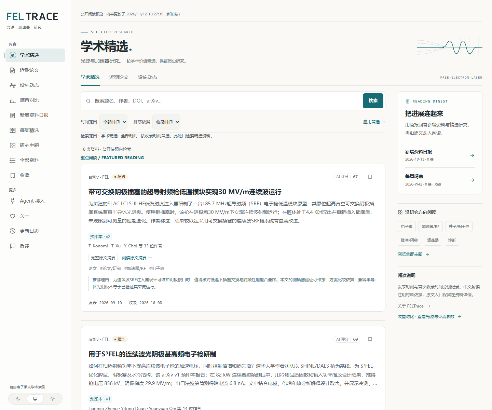
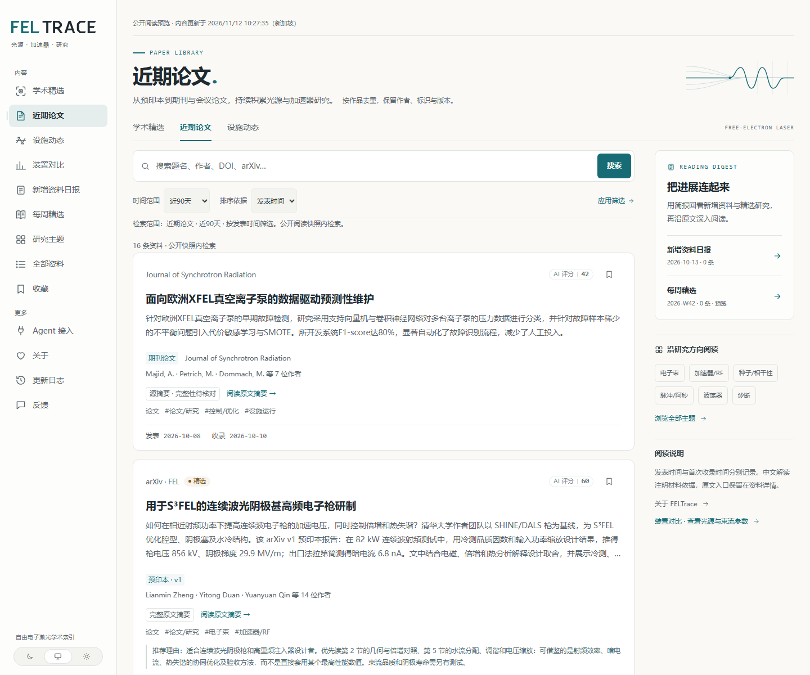
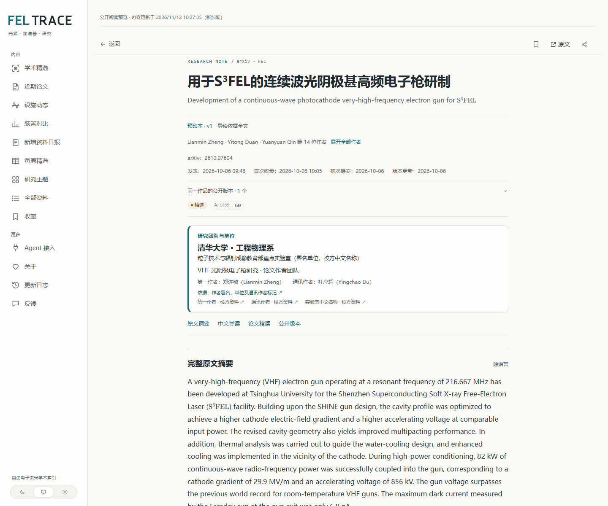
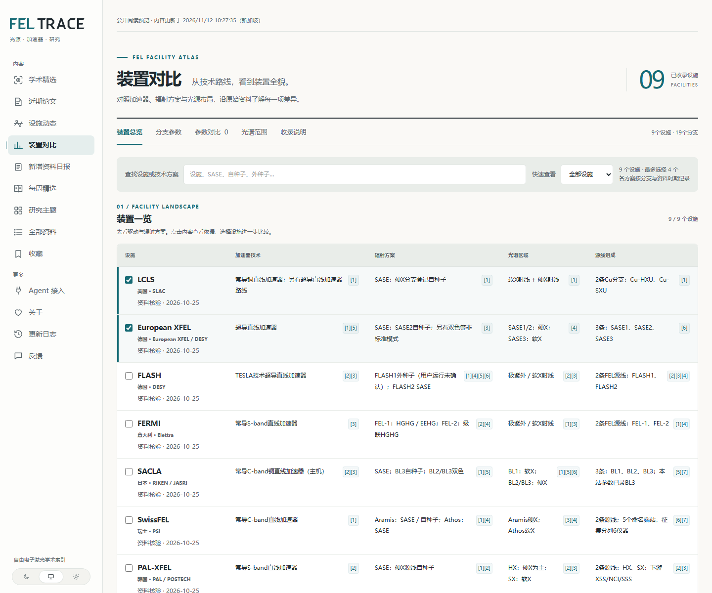

# FELTrace public reading preview

## 面向科研同事的案例展示

FELTrace 是自由电子激光光源与加速器方向的公开静态阅读快照，展示论文与设施资讯、公开版本检索、经复核的阅读笔记，以及带出处的装置参数对比。建议科研同事按以下**固定演示顺序**查看；每步均可直接打开公开页面，截图仅取自这些公开静态页面，不含本机个人图库、私有原件或未审阅内容。

### 1. 学术精选：先看研究线索与公开导读

[打开学术精选](https://powell-wu.github.io/feltrace/)，查看论文和设施资讯的精选理由、来源、发表时间与首次收录时间。

### 2. 论文库：再查公开版本与双日期

[打开论文库](https://powell-wu.github.io/feltrace/papers/)，按题名、作者、DOI 或 arXiv 检索，比较按发表时间与按首次收录时间筛选的结果，并查看同一作品的公开版本。

### 3. S³FEL 案例：核查五章笔记与原文定位

[打开 S³FEL 公开阅读案例](https://powell-wu.github.io/feltrace/items/nswmqetqjwbecehh6vi3afeh8/)，依次查看原摘要、研究团队、五章阅读笔记、公式和真实原文锚点。公开版保留图号、出处与缺图说明，不嵌入六张个人学习原图。

### 4. 装置对比：核对参数、工况与证据

[打开装置对比](https://powell-wu.github.io/feltrace/facilities/compare/)，查看 9 个设施、36 个配置和 17 项指标，展开来源、适用工况、资料阶段及版本说明；可从页面进入各设施研究页。

### 5. Agent 数据：最后使用机器可读公开投影

[查看 Agent 接入说明](https://powell-wu.github.io/feltrace/agent/)，或直接读取[论文 JSON](https://powell-wu.github.io/feltrace/data/papers.json)、[设施资讯 JSON](https://powell-wu.github.io/feltrace/data/facilities.json)、[精选 JSON](https://powell-wu.github.io/feltrace/data/selected.json) 和[装置参数 JSON](https://powell-wu.github.io/feltrace/data/facility-parameters.json)。这些文件只含公开投影；静态站不提供远程 MCP 或 REST 查询服务。

A static snapshot of the existing FELTrace public reading pages. Papers, facilities, selected research and report editions keep their public source attribution and dates. Search, filters, bookmarks and themes run in the browser. No backend credentials or database are shipped.

This repository contains public generated output under `site/`; initial snapshot history may remain in Git and deployments after later corrections. It is separate from the private collector workspace and the complete AIHOT reference archive.

## Refresh locally

Run the existing FELTrace service on localhost:3000. Install the pinned Cheerio dependency with `npm ci` in this directory, then run `npm run export` and `npm run test:snapshot`. In the original workspace the exporter can reuse the existing app's installed Cheerio package.

`npm test` runs the offline query and export regression suite against a disposable loopback fixture. It needs no database, private papers, generated site, external API or browser download. `npm run test:snapshot` separately checks the actual generated snapshot, including the reviewed S³FEL example. Set `FELTRACE_OUTPUT_DIR` for an isolated export and snapshot test instead of replacing `site/`.

The browser index retains all independently public version candidates; filters run before selecting a representative per work, matching the dynamic page's journal/arXiv version order. Publication and discovery ranges use their respective clocks. `items` and the machine feeds retain their representative-view counts; `candidates`, `memberships` and candidate cards support version-specific searches. Query-only subject tags do not become display tags. Snapshot queries use the snapshot's `generatedAt`, rather than the reader's device clock.

Unavailable optional images retain their caption and original-source links. The public `release.json` reports `status: degraded` and safe failure codes; detailed upstream errors, internal image-proxy URLs and signatures stay in ignored `.preview/export-diagnostics/` files. Missing stylesheets or their font/image dependencies fail the export before it replaces the previous candidate. Exports never publish automatically. Each catalogue facility has a static research page linking its parameters, cited material and related public research.

`npm run preview` serves http://127.0.0.1:4174/feltrace/. Commit only the reviewed public directory and push to this repository's `main` branch to run the Pages workflow. The export itself never pushes or starts collection/model work. No scheduled push is installed in this preview.

The first publication's public use/privacy copy was confirmed by the owner; see COPY_APPROVAL.md. GitHub Pages uses this public repository with the GitHub Actions build type. Live preview: https://powell-wu.github.io/feltrace/ . First deployed and checked on 2026-10-10; the snapshot time is displayed on every page.

## Attribution

The page rendering and styling derive from AIHOT, MIT licensed, with FELTrace customization. AIHOT brand assets are not used. See LICENSE. Third-party papers, abstracts and licensed figures retain their own rights and attributions; the code license does not relicense their content.

Formula markup, styles and fonts use KaTeX 0.19.0. Its MIT notice is retained in `licenses/KaTeX-LICENSE.txt` and the deployed `site/third-party/KaTeX-LICENSE.txt`.

## Agent data snapshots

The public `/agent/` page describes the capabilities of this static deployment. `/llms.txt` links to `/data/papers.json`, `/data/facilities.json`, `/data/selected.json` and the selected RSS feed. JSON snapshots include `schemaVersion`, `generatedAt`, `count` and public `items`; publication and discovery timestamps remain separate. Query/filter snapshots on the client. GitHub Pages does not host the local MCP or REST backend. Only already-public metadata, summaries and selected reading reasons are exported; restricted abstracts and article bodies are excluded.
